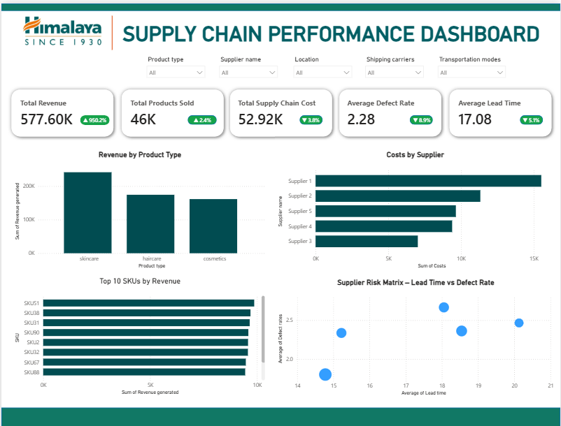

# Himalaya – Supply Chain Performance Dashboard

An interactive **Power BI dashboard** designed to monitor supply chain performance across product categories, suppliers, locations, shipping carriers, and transportation modes.

The dashboard brings together revenue, product sales, supply chain costs, defect rates, and lead times to help users explore operational performance and identify supplier-level trends and risks.

## Dashboard Preview

Add the dashboard screenshot to this repository and name it `dashboard.png` (or update the image path below to match your filename).



## Project Overview

This dashboard provides a consolidated view of key supply chain metrics. Users can filter the report by product type, supplier, location, shipping carrier, and transportation mode to examine performance from different operational perspectives.

## Interactive Filters

The dashboard includes the following slicers:

- **Product type** – Filter results by product category.
- **Supplier name** – Focus on an individual supplier.
- **Location** – Explore performance by location.
- **Shipping carriers** – Filter by shipping provider.
- **Transportation modes** – Compare different transportation methods.

## Key Performance Indicators

The supplied dashboard screenshot displays these headline metrics:

| KPI | Value shown |
|---|---:|
| Total Revenue | 577.60K |
| Total Products Sold | 46K |
| Total Supply Chain Cost | 52.92K |
| Average Defect Rate | 2.28 |
| Average Lead Time | 17.08 |

The dashboard also displays percentage-change indicators alongside the KPIs. These indicators are reproduced visually in the report and may depend on the comparison period or calculation used in the PBIX file.

## Dashboard Visuals

1. **Revenue by Product Type** – Column chart comparing revenue generated by product categories, including skincare, haircare, and cosmetics.
2. **Costs by Supplier** – Horizontal bar chart comparing supply chain costs across suppliers.
3. **Top 10 SKUs by Revenue** – Horizontal bar chart highlighting the highest-revenue stock keeping units (SKUs).
4. **Supplier Risk Matrix – Lead Time vs Defect Rate** – Scatter plot comparing suppliers by average lead time and average defect rate. This can help highlight suppliers that may need further review.

## Tools and Technologies

- **Microsoft Power BI Desktop** – Data preparation, modelling, KPI calculations, and dashboard visualisation.
- **Dataset** – Supply chain data provided with this project.
- **GitHub** – Project documentation and version control.

## Repository Structure

A suggested repository structure is:

```text
himalaya-supply-chain-dashboard/
│
├── README.md
├── dashboard.png
├── dataset/
│   └── your_dataset_file.xlsx
└── report/
    └── your_power_bi_report.pbix
```

Replace the example filenames with the actual names of the files you upload. You can also keep all files in the repository root, provided you update the structure shown here.

## How to View the Dashboard

1. Clone or download this repository.
2. Install and open **Microsoft Power BI Desktop**.
3. Open the `.pbix` report file.
4. If prompted, connect the report to the dataset included in this repository.
5. Refresh the data if required.
6. Use the slicers to filter the dashboard and explore supply chain performance.

## Notes and Data Considerations

- KPI values shown in this README are taken from the supplied dashboard screenshot. They may change when filters are applied or the underlying dataset is refreshed.
- Confirm that the dataset path, table names, and column names match the data source configured in the PBIX file.
- Do not publish confidential supplier, commercial, or business information unless you have permission to share it.
- The supplier risk matrix is an analytical view and should be interpreted alongside business context and appropriate operational thresholds.

## Author

**Harshit Kumar Pandey**\
MBA -- Business Analytics\
Interested in Data Analytics, Business Intelligence, and data-driven
decision-making.

------------------------------------------------------------------------

If you find this project useful, feel free to ⭐ the repository.

## Disclaimer

This dashboard is a data-analytics portfolio/academic project. Company names and labels are used to describe the dataset and dashboard subject. The analysis is based on the dataset provided with this repository and should not be interpreted as an official company report or as independently audited financial information.


